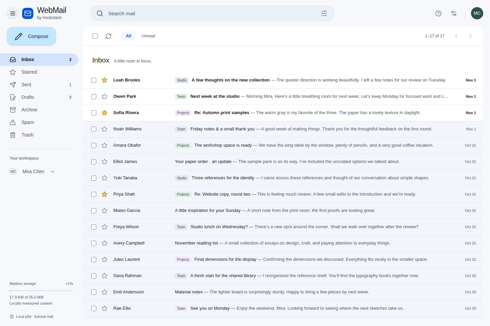
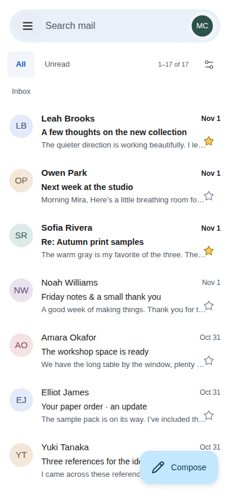
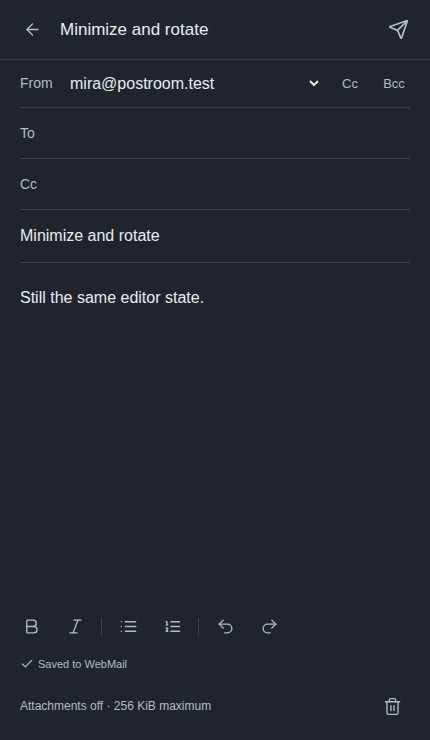
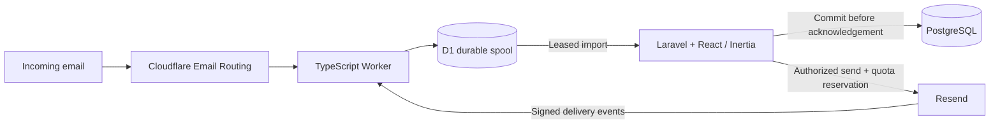

# WebMail by Hookstack — Open-source Laravel Webmail

**A private, self-hosted webmail application for small teams, built with Laravel 13, React, Inertia and PostgreSQL.** WebMail by Hookstack combines a Gmail-inspired desktop inbox with a distinct mobile interface, administrator-managed accounts, Cloudflare Email Routing for incoming mail and Resend for outgoing mail. Ordinary users do not need provider accounts.

[Get started](#run-locally-with-docker-and-postgresql) · [Architecture](#architecture) · [Documentation](#documentation) · [Contributing](CONTRIBUTING.md) · [Security](SECURITY.md) · [MIT license](LICENSE)

[](https://github.com/RishadAlam/webmail/actions/workflows/ci.yml)

**Local milestone, not a deployed mail service.** Provider adapters and deterministic simulators are implemented. External sending is disabled by default. No live email, DNS, provider account or paid resource has been changed. See [STATUS.md](STATUS.md) for executed tests and remaining release gates, and [the UI evidence report](docs/UI_REPORT.md) for the supplied acceptance checklist.

## Desktop and mobile previews

Desktop uses a full-width mailbox and conversation route with an optional reading pane. Phones use a drawer, full-screen search, reader and composer. Both layouts share authorized mailbox access and versioned server drafts. WebMail has its own branding and is not affiliated with Google or Gmail.



<details>
<summary>Mobile inbox and composer</summary>

<p>
  
  
</p>

</details>

These screenshots use fictional messages and browser-emulated viewports. They do not establish physical-device, offline draft or live-delivery support.

## Why WebMail

- **Your team's mail, in your application.** Manage people, aliases, shared mailbox memberships and quotas without giving members provider accounts.
- **Familiar email workflows.** Search, conversations, labels, reply/reply-all, forwarding, keyboard controls, light/dark appearance and shared autosaving drafts.
- **Durability before acceptance.** Store inbound MIME before accepting it; retain drafts and ambiguous send outcomes so failures do not silently lose work.
- **Server-enforced access.** Administrator MFA, explicit mailbox permissions, permitted sender identities, encrypted credentials and bounded quota reservations.
- **Strict-free safeguards.** No paid extensions, R2 activation, automatic overages or artificial keep-alives. Unknown usage remains unknown.

Separate attachment handling, complete provider provisioning and the other [release gates](STATUS.md) remain unfinished. This is a pilot for evaluation and development, not a production availability promise.

## Architecture



Laravel **13.39.0** is pinned in `composer.lock`; frontend and Worker dependencies are pinned in `package-lock.json`. PostgreSQL is the application source of truth. The intended hosting profile is Render Free with Neon Free PostgreSQL; neither a deployment nor live provider delivery is implied by this diagram. See [verified sources](SOURCES.md) for versions, endpoints and plan limitations.

## Run locally with Docker and PostgreSQL

Docker Compose is the production-compatible database profile. Its database lives in the `postroom-db` named volume; the PHP development server is local-only. These setup commands are for a new checkout. Keep an existing `.env` and `APP_KEY`; replacing the key makes encrypted stored mail unreadable.

```sh
git clone https://github.com/RishadAlam/webmail.git
cd webmail
cp -n .env.example .env
docker compose build
docker compose run --rm app composer install
docker compose run --rm app php artisan key:generate
docker compose run --rm app php artisan migrate
docker compose run --rm app php artisan db:seed --class=DemoSeeder
docker compose run --rm app npm ci
docker compose run --rm app npm run build
docker compose up -d
```

Open [WebMail locally](http://localhost:8082). Normal restarts only need `docker compose up -d`. Do not use `down -v` unless you intend to delete the local database. This is not a Render production image.

The fictional demo member is `mira@postroom.test`, password `postroom-local-only`. The fictional owner is `owner@postroom.test`, with the same password and the local-only authenticator seed `JBSWY3DPEHPK3PXPJBSWY3DPEHPK3PXP`. The demo recovery code is `fictional-recovery-code`. These are public fixtures, never production credentials. The seed refuses to run outside local/testing mock mode. The owner cannot read Mira's mailbox.

## Direct local profile

Requires PHP 8.4+, Composer 2, and Node 22.18+ or 24.11+. The verified local Node release was 22.23.4. Install the PHP extensions required by `composer check-platform-reqs`, including SQLite for this convenience profile.

```sh
cp -n .env.example .env
composer install
php artisan key:generate
php -r "if (!is_file('database/database.sqlite')) touch('database/database.sqlite');"
php artisan migrate
php artisan db:seed --class=DemoSeeder
npm ci
npm run build
php artisan serve --no-reload --host=127.0.0.1 --port=8000
```

SQLite is only a local convenience. Production startup refuses non-PostgreSQL storage. `npm run dev` is available for development; browser/security evidence uses the built assets and the normal CSP. No paid editor extension or external font service is needed.

The local and test servers use `--no-reload` so Laravel preserves inherited database and security settings when starting PHP. Restart the server after changing environment configuration; PHP source changes still apply on the next request. Without this flag, the server can silently fall back to `.env` instead of the Compose or Playwright database.

## Verification

```sh
php artisan test
vendor/bin/pint --test
vendor/bin/phpstan analyse --no-progress
npm run check
npm run types:check
npm run types:worker
npm run test:worker
npm run build
npx playwright install chromium firefox webkit
npm run test:e2e
POSTROOM_BROWSER=firefox npm run test:e2e
POSTROOM_BROWSER=webkit npm run test:e2e
```

Playwright owns only `storage/e2e.sqlite`, seeds fictional messages, starts port 8010, and applies a deliberately small two-recipient daily test cap. It does not reset the normal application database. The guarded acceptance seeder adds a separate mailbox with 78 messages for paging, long conversations and newsletter/detail checks; the original 17-message inbox remains intact. Browsers may require OS libraries (`npx playwright install-deps`); physical devices remain a separate gate. Traces and authentication state are ignored by source control. Screenshots in `docs/ui-evidence` and `docs/review/final` contain fictional data only. Do not rebuild shared frontend assets while browser tests are running.

For PostgreSQL checks, first create **dedicated disposable** databases `postroom_test`, `postroom_concurrency`, and `postroom_auth_e2e` in the local container. The concurrency and HTTP authentication scripts each enforce their own database name and testing environment:

```sh
docker compose exec -T postgres createdb -U postroom postroom_test
docker compose exec -T postgres createdb -U postroom postroom_concurrency
docker compose exec -T postgres createdb -U postroom postroom_auth_e2e
docker compose exec -T -e APP_ENV=testing -e DB_DATABASE=postroom_test app php artisan test
docker compose exec -T -e APP_ENV=testing -e DB_DATABASE=postroom_concurrency app php scripts/verify-concurrency.php
docker compose exec -T -e APP_ENV=testing -e DB_DATABASE=postroom_auth_e2e app php artisan migrate --force
docker compose exec -T -e APP_ENV=testing -e DB_DATABASE=postroom_auth_e2e app php scripts/verify-auth-runtime.php
```

## Implemented boundaries

- Authentication without signup, owner/admin MFA session verification, server mailbox policies, no implicit administrator access to mail, original WebMail by Hookstack branding. Managed email identities cannot be self-edited; suspension/password changes invalidate other sessions and remembered logins. Self-service account deletion is disabled to preserve accepted mail.
- Authorized all-mail metadata search, paginated conversations, Reply-To-aware reply/reply-all, forward drafts, star/read/archive/spam/trash/labels, version-checked Undo, shared autosaving composer, recipient validation, permitted From identities and saved preferences. Mark unread returns to the list without immediately undoing itself.
- User creation/suspension, session revocation, member password reset, bounded aliases/shared mailboxes/memberships/storage quotas and usage/delivery/audit views inside WebMail. New receiving addresses remain **pending directory synchronization** until an acknowledged versioned snapshot; deterministic local sync is labeled simulated.
- Owner-only encrypted connection save/rotation/clear, masked state and bounded read-only access checks. Credential changes require current MFA and recent password confirmation; ordinary users need no provider accounts. Connection checks do not prove live delivery.
- Transactional recipient reservations, immutable send intents, ambiguous outcomes kept separate from acceptance/delivery, recipient-level signed event processing, retained drafts on failure. Definite failures can be copied; uncertain sends cannot be blindly retried.
- Bounded MIME persisted in D1 before acceptance; leased imports acknowledge only after database commit. Raw MIME is retained; active HTML is sanitized and sandboxed, remote images blocked. Authorized users can download the original `.eml`, including its retained attachments. Separate attachment upload/preview/download is disabled.
- Explicit permanent deletion of selected Trash mail requires typed confirmation. Import tombstones, send evidence and reservations survive deletion; storage accounting retains all saved and immutable reference drafts. No automatic purge of unimported accepted mail.
- Public-static-only service-worker cache, public offline explanation and private history/session checks. No durable offline draft, push, background send or native keyboard claim.

The default application budgets are 5 people, 25 MiB per mailbox, 350 MiB logical organization content, a 50 MiB accounted D1 spool, 256 KiB encoded MIME and a 750 MiB physical PostgreSQL admission ceiling. These are **application safeguards**, not provider plan guarantees. Unknown provider usage stays unavailable; stale outbound usage blocks admission. Quota reconciliation intentionally errs toward holding mail.

## Provider bootstrap and deployment

The Worker is in `worker/`, with D1 schema, signature verification and local runtime tests. `worker/wrangler.jsonc` deliberately contains undeployed placeholders. Its scheduled wake occurs only for an actual pending backlog, with backoff; there are no keep-alive pings.

The current control plane supports in-app encrypted connections, bounded read-only Cloudflare zone/DNS inspection, versioned recipient-directory synchronization and routine supported mailbox administration. The complete resumable domain/DNS/routing/Worker/webhook provisioning wizard, role/ownership transfer and incident-reconciliation UI remain unfinished. No DNS mutation is implemented or silently attempted.

`Dockerfile` is the separate hardened PHP/Apache runtime; `render.yaml` declares a Free web service with automatic deploys off. See [deployment and recovery](docs/DEPLOYMENT.md), [recipient-directory protocol](docs/RECIPIENT_DIRECTORY.md) and [administration/retention](docs/ADMINISTRATION_AND_RETENTION.md). Local TLS/container and PostgreSQL restore drills have passed; they are not proof of Render/Neon deployment. Render expressly describes Free as unsuitable for production applications, so strict-free hosting remains a limited pilot without an availability guarantee.

Provider account creation/authorization, initial hosting/database deployment, application master-key creation and the single-use interactive `webmail:bootstrap-owner` command are owner bootstrap exceptions. The current implementation has no browser installation-claim wizard. Billing, account verification/appeals, inaccessible Free metrics and offline disaster recovery remain provider/owner responsibilities. Before changing DNS or routing, generate an exact diff and obtain explicit approval. Do not activate R2, paid Workers, overages, extra quota-evasion accounts or keep-alives.

Go-live still needs the unfinished provisioning/reconciliation work, actual free-account verification, real Cloudflare/Resend mail tests, Worker Free CPU measurement, Neon TLS and off-machine backup/restore, hosted cold-start observation and physical-device acceptance. See [PLAN.md](PLAN.md), [SOURCES.md](SOURCES.md) and [STATUS.md](STATUS.md). The [Gmail comparison](docs/GMAIL_COMPARISON.md) explains the UI choices and their evidence limits.

Existing configuration keys, database names, protocol headers, source directories and fictional `postroom.test` identities retain their legacy names to preserve compatibility. They are internal identifiers, not the displayed product name.

## Documentation

| Guide                                                          | What it covers                                                      |
| -------------------------------------------------------------- | ------------------------------------------------------------------- |
| [Status and release gates](STATUS.md)                          | Executed checks, known gaps and next steps                          |
| [Implementation plan](PLAN.md)                                 | Product scope and phased delivery                                   |
| [Deployment and recovery](docs/DEPLOYMENT.md)                  | Runtime, owner bootstrap, strict-free limits and restore procedures |
| [Mailbox administration](docs/ADMINISTRATION_AND_RETENTION.md) | Accounts, membership, quotas and permanent deletion                 |
| [Recipient directory](docs/RECIPIENT_DIRECTORY.md)             | Worker synchronization protocol and failure handling                |
| [Desktop design](DESIGN.md) / [mobile UX](MOBILE_UX.md)        | Layouts, interactions, accessibility and draft preservation         |
| [UI acceptance evidence](docs/UI_REPORT.md)                    | Browser results, screenshots and untested device behavior           |
| [Official sources](SOURCES.md)                                 | Verified provider documentation and pinned dependencies             |

## Contributing and support

WebMail is created by **Hookstack**. Read [CONTRIBUTING.md](CONTRIBUTING.md) before proposing changes. Use [GitHub issues](https://github.com/RishadAlam/webmail/issues) for reproducible bugs and feature proposals, and follow [SECURITY.md](SECURITY.md) for private vulnerability reports. Never post credentials, recovery codes, real messages or database exports.

## License and acknowledgements

WebMail is available under the [MIT license](LICENSE). It builds on the Laravel React starter kit and other open-source dependencies; see [third-party notices](THIRD_PARTY_NOTICES.md). Provider accounts and services retain their own terms and limits.
